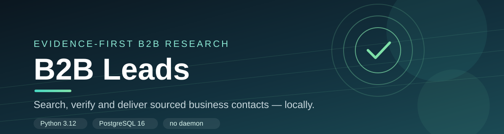
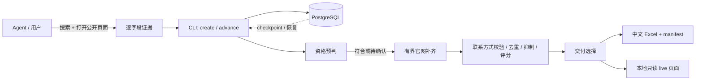

<p align="center">
  
</p>

<h1 align="center">B2B Leads</h1>

<p align="center">
  <b>给 AI Agent 的 B2B 线索研究技能</b><br>
  每条事实可追溯，每条联系方式可复核，最后交付一份带来源的中文 Excel。
</p>

<p align="center">
  
  
  
  <a href="https://github.com/Benuuh/b2b-leads-skill/actions/workflows/ci.yml"></a>
  
  <a href="LICENSE"></a>
</p>

<p align="center">
  <a href="#quick-start">Quick Start</a> ·
  <a href="#why-b2b-leads">Why</a> ·
  <a href="#how-it-works">How it works</a> ·
  <a href="#features">Features</a> ·
  <a href="#benchmarks">Benchmarks</a> ·
  <a href="#docs">Docs</a>
</p>

---

**B2B Leads** 是一个本地运行的获客研究技能：Agent 负责搜索和打开公开页面，提交逐字段证据；Python 核心负责资格判断、有限官网补齐、联系方式校验、去重、抑制、预算、恢复和文件交付。

它**不是**一个批量爬虫，也**不是**一个自动发信/写 CRM 的 SaaS。它只回答一个问题：**这家企业是否符合目标客群，并且是否有可复核的公开商务联系方式？**

## Quick Start

> 需要 Python 3.12、PostgreSQL 16，以及可创建数据库的本地连接。没有常驻 worker、HTTP API 或登录服务。

```powershell
git clone https://github.com/Benuuh/b2b-leads-skill.git
cd b2b-leads-skill

python -m venv .venv
.\.venv\Scripts\python.exe -m pip install -r backend/requirements.lock
.\.venv\Scripts\python.exe -m pip install --no-deps -e backend

Copy-Item .env.example .env
# 编辑 .env 中的 SCA_DATABASE_URL，替换本地密码
.\.venv\Scripts\python.exe scripts/b2b_leads.py prepare
```

macOS / Linux 把 `.venv\Scripts\python.exe` 换成 `.venv/bin/python`。

### 用 Agent 跑一单

安装 `skills/b2b-leads` 后，直接说：

```text
用 $b2b-leads 找 200 家美国货代，要公开商务联系方式，导出中文 Excel。
```

Agent 会按 Skill 的流程搜索、打开页面、提交证据并调用下面的核心命令。也可以手动走 CLI：

```powershell
New-Item -ItemType Directory -Force .runtime\b2b-leads | Out-Null
@'
{
  "name": "美国货代公开商务联系方式",
  "industry": "freight forwarding",
  "countries": ["US"],
  "quantity": 200
}
'@ | Set-Content .runtime\b2b-leads\spec.json -Encoding utf8

.\.venv\Scripts\python.exe scripts/b2b_leads.py create `
  --run us-freight-20261108 --spec-json .runtime\b2b-leads\spec.json

# Agent 提交带来源摘录的企业证据；首轮建议 5 家，之后每轮 10–20 家
.\.venv\Scripts\python.exe scripts/b2b_leads.py advance `
  --run us-freight-20261108 --chunk round-01 `
  --input-json .runtime\b2b-leads\round-01.json --max-jobs 20 --max-seconds 60

.\.venv\Scripts\python.exe scripts/b2b_leads.py status --run us-freight-20261108
.\.venv\Scripts\python.exe scripts/b2b_leads.py export --run us-freight-20261108
.\.venv\Scripts\python.exe scripts/b2b_leads.py live   --run us-freight-20261108
```

`round-01.json` 不是关键词列表，而是**逐字段证据**：每一项事实/联系方式都要有来源 URL、页面摘录和采集时间。完整格式见 [证据合同](skills/b2b-leads/references/evidence-contract.md) 和 [控制器参考](skills/b2b-leads/references/controller.md)。

## Why B2B Leads

普通“AI 找客户”工具通常从一个模糊的搜索摘要直接编出一家公司、一个邮箱。B2B Leads 反过来：

- **证据先行**：搜索摘要、模型推断、置信度分数都不算事实。`company_name`、总部国家、业务模式、产品/服务、联系方式必须各自绑定一条可复查的来源。
- **先判断，再找联系方式**：不符合冻结客群条件的企业不会进入官网深挖；符合但缺渠道的企业才由核心有界补齐。
- **不会为了凑数放宽门槛**：资格、渠道政策、去重、抑制、freshness 和评分全部通过，才进入正式 Excel。
- **中断可恢复**：chunk / operation replay、租约、checkpoint 和暂停/恢复都在 PostgreSQL 中持久化；不依赖常驻进程。
- **本地优先**：PostgreSQL、页面工件和导出文件都在你自己的机器上；没有云端账号，也没有常驻服务。

## How it works



一次研究被拆成四层：

1. **Agent 层**：发现企业、打开公开页面、提交带摘录的证据。
2. **协调层**：`create` 冻结客群与执行政策；`advance` 原子预检+追加+有界处理；`status` / `pause` / `resume` / `finish` 管理生命周期。
3. **单企业层**：先复用已保存证据；需要时最多两页确认资格，通过后继续补齐，单企业合计最多十页；满足渠道目标提前停止。
4. **交付层**：统一做资格、渠道、去重、抑制和 freshness 过滤；导出四张表并写入可校验的 manifest。

## Features

| | |
|---|---|
| **证据合同** | 每个事实和渠道独立来源；摘自页面原文；拒绝搜索摘要；主体不一致不算。 |
| **可配置客群** | `spec_version: 2` 把资格条件、渠道政策、freshness、页面预算和 worker 数冻结到 run。 |
| **渠道政策** | `any` / `all`、邮箱/电话/联系表单、具名联系人、角色要求分别判断。 |
| **去重与 ownership** | 共享 domain / email / phone / form 在交付过滤前冻结归属，不能把渠道“转移”给另一家。 |
| **抑制名单** | 全局 suppression + 客群 exclusions；被排除的联系方式不会从来源表泄漏。 |
| **可恢复** | 操作账本、租约、重试、checkpoint、chunk replay、暂停/恢复。 |
| **有界访问** | robots、DNS 固定、host limiter、429 cooldown、页面/企业/批次预算；不绕过访问控制。 |
| **可审计交付** | 四表 Excel、来源行、行数、覆盖率和 SHA-256 manifest；已撤销/过期导出会校验失败。 |
| **本机 live 页面** | 用户主动启动、只绑定 `127.0.0.1`、带随机 token 的短时只读页面。 |

## Output

默认导出 `xlsx`，中文表头，平衡模式：

| Sheet | 内容 |
|---|---|
| `Companies` | 企业、国家/地区、行业、官网、评分、资格状态、缺失项、冲突项 |
| `Contacts` | 联系人、职位、邮箱/电话、验证状态、优先级、来源 |
| `Sources` | 每条字段级证据：实体、字段、值、来源 URL、摘录、方法、时间 |
| `Manifest` | 版本、配置 hash、规则、行数、覆盖率、质量指标、交付政策、文件 hash |

同时返回 `discovered / matched / contactable / excluded / uncertain / evidence-missing / shortfall` 等计数。数量不足时交付已有结果并明确报告缺口，不把缺口藏进“完成”。

## Benchmarks

2.7.0 对协调器、交付选择和导出路径做了去重优化。固定合成 replay，隔离 PostgreSQL；下表为同 fixture 的旧/新 p95（不启用 `tracemalloc`）：

| 场景 | 2.6.0 | 2.7.0 | 变化 |
|---|---:|---:|---:|
| 600 家时 append 20 家 | 41.642 s | 1.230 s | **-97.0%** |
| 600 家 status | 11.409 s | 1.102 s | **-90.3%** |
| 200 家冷导出 xlsx | 24.717 s | 2.335 s | **-90.6%** |
| 200 家单公司 complete | 7.265 s | 0.907 s | **-87.5%** |
| 20 jobs 全量 selection | 约 21 次 | 2 次 | **-90.5%** |

append cohort 扩展：0 家 `0.051 s`、200 家 `0.432 s`、600 家 `1.230 s`、1000 家 `2.025 s`，selection 始终 1 次。导出 1000 家约 `7.0 s`。

> 这些是固定 replay 的工程基准，不是真实 200 家在线交付 SLA；公开渠道有来源证据也不代表邮件/电话实际可达。原始 JSON 与口径见 [bench/README](bench/README.md) 和 [运行效率实施记录](docs/IMPLEMENTATION-runtime-efficiency-v2.6.md)。

## Safety & privacy

- 不自动发送邮件、不打电话、不写 CRM；只产出名单和证据。
- 不绕过 robots、登录、CAPTCHA、付费墙或访问控制；不启用共享目录自动采集。
- 不把搜索摘要、模型推断或“看起来像”的邮箱当成事实。
- 默认不启用付费数据源；没有 API key 也可以完成核心流程。
- 数据库、页面工件、导出文件和 `.env` 不进仓库；公开仓库只包含脱敏源码和合成 benchmark。
- 处理个人商务联系方式时，使用方需自行确认合法依据、用途和当地合规要求。

## Project layout

```text
skills/b2b-leads/       Agent 工作指引、controller 薄包装和 references
scripts/                命令入口、安装、数据库生命周期、备份、benchmark
backend/app/
  cli.py                解析命令并输出 JSON
  capabilities.py       版本化能力注册表（离线）
  schemas.py            客群配置 v1/v2 与输入合同
  runs/                 批次生命周期、候选、租约、幂等、快照
  pipeline.py           单企业处理顺序、证据优先与预算
  rules/                资格、身份、联系方式、评分
  web/                  安全 HTTP、官网抓取、DNS/MX、请求观测
  delivery/             渠道政策、公共筛选、质量指标、Excel/CSV
  live/                 已提交状态投影与本机短时只读页面
  persistence/          PostgreSQL、文件、备份恢复
backend/tests/          规则及隔离 PostgreSQL 集成测试
docs/                   architecture、operations、specs、实施记录
bench/                  合成 cohort 的 A/B 基准原始结果
```

## Docs

| 文档 | 内容 |
|---|---|
| [SKILL.md](skills/b2b-leads/SKILL.md) | Agent 入口、边界、研究/交付流程 |
| [controller.md](skills/b2b-leads/references/controller.md) | 全部 CLI 命令与运行语义 |
| [evidence-contract.md](skills/b2b-leads/references/evidence-contract.md) | 候选、事实、渠道和 form 的证据格式 |
| [segment-spec.md](skills/b2b-leads/references/segment-spec.md) | v2 客群配置、字段和运算符 |
| [architecture.md](docs/architecture.md) | 模块边界与数据流 |
| [operations.md](docs/operations.md) | 安装、数据库、备份、维护 |
| [SPEC-runtime-efficiency-v2.6.md](docs/specs/SPEC-runtime-efficiency-v2.6.md) | 2.7.0 运行效率规格与验收口径 |
| [IMPLEMENTATION-runtime-efficiency-v2.6.md](docs/IMPLEMENTATION-runtime-efficiency-v2.6.md) | 2.7.0 实施记录、测试、基准和回滚 |

## Development

```powershell
.\.venv\Scripts\python.exe -m pytest backend/tests -q
```

当前完整测试：**486 passed**。数据库测试使用临时 `sca_test_*` 数据库；没有 PostgreSQL 配置时跳过，跳过不算验收通过。

数据库不可用时明确报错；不会回退到 SQLite。已有旧表的数据库会被拒绝，不重置旧迁移。默认业务库为 `sca_skill_v2`，工件目录为 `data/skill-v2/`（或 `SCA_ARTIFACT_ROOT`）。

## Limitations

- 公开渠道“有来源”不等于“可送达”；邮箱/电话仍需实际验证。
- 不做自动 JS 渲染/Selenium 绕过；无法访问的站点会记录原因并走替代来源。
- 默认无付费数据源；`eu_ted` / `eurostat_comext` / `google_places` 是可选发现支路。
- 数量范围 50–1000，默认目标 200，候选上限三倍，累计非暂停八小时；一次最多追加 20 家。
- 固定 replay 的 benchmark 不代表真实 200 家任务的在线时延或成功率。
- v1 批次保持历史语义，不用 v2 条件重新判定。

## License

MIT License，Copyright (c) 2026 Benuuh。可以商用、修改、再分发，只需保留版权声明和许可证文本。完整条款见 [LICENSE](LICENSE)。

第三方依赖和历史许可证见 [NOTICE](NOTICE) 与 `third_party/licenses/`；它们不因本项目的 MIT 许可证而改变。
