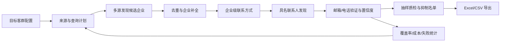

# 通用 B2B 海外获客与联系方式补齐系统 — 业务需求文档（BRD）

| 项目 | 内容 |
|---|---|
| 文档编号 | BRD-ACQ-001 |
| 版本 | v1.0（业务确认版） |
| 日期 | 2026-10-20 |
| 状态 | 已确认，可交给设计/实现 Agent |
| 读者 | 业务负责人、产品/设计 Agent、实现 Agent |
| 范围 | 业务需求、数据与验收标准；技术架构由后续设计 Agent 产出 |
| 依据 | 2026-10-20 需求访谈（第三轮） |
| 预算约束 | 首版无付费预算，仅使用免费公开来源/免费额度/现有算力 |

实现文档同步（2026-10-24）：当前实现采用 Skill 单入口直接调用 Python 核心，见[模块与数据流](../docs/architecture.md)、[操作手册](../docs/operations.md)和[当前生产验收口径](../docs/production-acceptance.md)。本文 v1.0 保留原业务需求基线；旧界面/API 架构已退出当前版本。当前 `quantity` 表示可交付企业目标，不能与本文早期“200 候选、160 合格”的阶段标准混用；真实业务指标仍需 pilot 验证。

**变更记录**

| 版本 | 日期 | 变更 |
|---|---|---|
| v0.1 | 2026-10-20 | 首版：通用 B2B 海外获客、联系方式补齐、Excel/CSV 导出 |
| v0.2 | 2026-10-20 | 确认首批为美国物流行业（后细化为货代）；零付费预算；单人/中文；公开商务数据；首版不做正式人工复核；允许公开社媒；补充数据保留建议 |
| v1.0 | 2026-10-20 | 确认子行业为货代/Freight Forwarding；企业规模/目标角色首版不限；数据保留采用推荐方案（后续可改）；定稿供设计/实现 Agent 使用 |

---

## 0. 阅读指南

- **MUST / 必须**：MVP 必须满足，缺失则不能验收。
- **SHOULD / 应该**：第一阶段应尽量满足，可在后续迭代补齐。
- **MAY / 可以**：可选能力，不阻塞 MVP。
- **P0 / P1 / P2**：P0 = MVP 必须；P1 = 第二阶段；P2 = 后续增强。
- 文中标注 **【待确认】** 的内容，需要业务负责人拍板后才能冻结。
- 本文只定义“做什么、为什么、怎么验收”，不规定技术栈、数据库和 API 形态；这些由设计 Agent 决定。

### 0.1 已确认的业务决策

| 决策 | 结论 |
|---|---|
| 目标市场 | 美国（第一批）；后续国家待定 |
| 行业/子行业 | 物流 — 货代 / Freight Forwarding（第一批）；地区待定 |
| 目标企业规模 | 不限，先按行业 + 地区抓 |
| 目标角色 | 不限，先抓企业公开渠道；后续再细化 |
| 客户类型 | 只做 B2B 企业 |
| 联系方式深度 | 企业公开渠道 + 尽量补具名联系人 |
| 可用来源 | 免费公开来源：官网/地图/企业目录/协会展会、公开社媒/新闻/招聘/招标、邮箱模式推测 + 免费验证；LinkedIn 公开资料（不登录） |
| 付费来源 | 无付费预算；首版不启用付费数据源/验证服务/代理 |
| 批次规模 | 200–1000 家企业/批，每周多次；首版建议 200 家/批 |
| 人工复核 | 首版以自动质量校验为主，不做正式复核；Phase 0 做一次 50 条校准（如需要可启用） |
| 交付形式 | 只导出 Excel/CSV，不做自动发信/CRM 写入 |
| 用户 | 单人使用 |
| 界面语言 | 中文 |
| 数据保留 | 采用 §11.2 推荐方案，后续可改 |
| 旧项目 | 先出需求文档，技术路线后续再定 |
| 文档深度 | 完整业务需求 + 验收标准（本文） |

> 以上来自 2026-10-20 需求访谈；“个人商务联系方式”的边界见 §9.5，已确认仅限公开商务场景。

---

## 1. 背景与问题

### 1.1 业务背景

需求方要做**海外 B2B 获客与客户开发**，但不限定行业和产品品类。目标客群由业务方按批次提供，系统负责把“目标客群描述”变成“可导出的企业 + 联系人名单”。

第一批已明确为**美国货代 / Freight Forwarding**；企业规模和目标角色首版**不限**，先按行业 + 地区抓企业公开渠道。首版**无付费预算**、**单人使用**、**中文界面**，允许使用**公开社媒/LinkedIn 公开资料**（不登录、不抓私密数据）。具体地区（全国或 1–2 个州/港口城市）仍待细化。

当前没有固定的产品方向，因此系统必须是**行业无关、国家可配置**的通用引擎，而不是为某一个产品画像定制的工具。

### 1.2 现有方式的痛点

1. **来源分散**：搜索、地图、企业目录、协会/展会名单、社媒、官网，人工逐个翻，效率低。
2. **联系方式难找**：官网联系页、脚注、PDF、地图商家页、社媒资料各有一半，人工拼不完整。
3. **重复严重**：同一家企业在不同来源名称/域名/地址不一致，人工去重靠感觉。
4. **质量不可控**：邮箱是否可达、电话是否有效、联系人是否还在职，缺少验证和标注。
5. **无法规模化**：每批 200–1000 家、每周多次，人工流程撑不住。
6. **无法追溯**：联系方式从哪来、什么时候抓的、可信度多少，没有记录，后续无法复核。
7. **导出不可用**：字段不统一、缺来源、缺置信度，导进 Excel/CRM 还要二次清洗。

### 1.3 为什么旧项目不匹配

旧项目以“产品画像匹配 + 证据链 + 逐条人工审核”为中心，适合单一行业、受控小批量、高审核强度的场景。本次需求的核心是：

- **行业无关**：不预设产品、行业、词表；
- **联系方式优先**：以邮箱、电话、具名联系人的覆盖率为核心指标；
- **规模优先**：单批 200–1000 家，每周多次；
- **导出优先**：最终交付是 Excel/CSV，不需要复杂审核工作台。

因此，旧项目的产品模型、固定词表、低批量限制和保守的联系方式策略都不适配。旧项目的任务队列、网页采集、去重、导出等基础能力**可以参考或复用**，但产品逻辑需要重做；是否复用由后续技术方案决定。

---

## 2. 产品定位

### 2.1 一句话定义

**输入目标客群，输出可导出的企业 + 联系人名单；不绑定行业和产品，以联系方式覆盖率、可验证性和可追溯性为核心。**

### 2.2 它是什么 / 不是什么

| 它是 | 它不是 |
|---|---|
| 通用 B2B 获客与联系方式补齐引擎 | 自动发信/群发工具 |
| 多来源企业发现与去重系统 | CRM 或销售流程管理系统 |
| 公开联系方式采集、推断、验证工具 | 私人数据/泄露数据获取工具 |
| 可追溯的 Excel/CSV 名单生产工具 | 实时客户意向或采购需求数据库 |
| 按批次运行、可恢复的流水线 | 7×24 持续监控的客户雷达 |

### 2.3 核心原则

1. **来源可追溯**：每个企业字段、邮箱、电话都要能回到来源 URL 或数据供应方记录。
2. **验证优先于数量**：优先给“已验证/高置信度”的联系方式；推测和未验证数据必须明确标注。
3. **公开合法**：只采集公开可访问、用于业务联系的信息；不碰登录后数据、私密数据、泄露数据。
4. **先企业后个人**：先保证企业级公开渠道，再尽量补具名联系人。
5. **批次可复现**：同一目标客群、同一来源策略，应能复现同一批结果的范围和口径。
6. **人工只做抽检**：单批 200–1000 家，不可能逐条审核；用抽样质检 + 置信度过滤控制质量。

### 2.4 非目标（本阶段明确不做）

- 不做 B2C 个人消费者获客。
- 不做自动发邮件、自动加 LinkedIn、自动拨号、会议预约、回复管理。
- 不做 CRM 写入或销售流程管理（只提供 Excel/CSV 和字段映射）。
- 不做私密/登录后/泄露数据获取，不做验证码绕过、手机号推断、撞库。
- 不做实时采购意向、海关交易明细或“谁正在采购”的判断。
- 不做多租户 SaaS、复杂组织权限、计费系统。
- 不做固定行业词表；行业/国家通过配置和来源 playbook 扩展。
- 不做逐条人工审核；只做抽样质检和异常复核。

---

## 3. 目标与成功指标

### 3.1 业务目标

| ID | 目标 | 说明 |
|---|---|---|
| G-1 | 行业/国家无关 | 不改代码，只改配置和来源策略，就能跑不同行业、不同国家 |
| G-2 | 企业覆盖 | 每批找到足够数量的目标企业，且可去重、可复核 |
| G-3 | 联系方式覆盖 | 尽可能补齐企业邮箱、电话、具名联系人 |
| G-4 | 联系方式质量 | 邮箱可验证、电话可规范化、推测数据有标注 |
| G-5 | 规模与时效 | 单批 200–1000 家，每周多次，批次可恢复 |
| G-6 | 可导出 | Excel/CSV 字段完整、可直接使用 |
| G-7 | 合规与审计 | 来源、采集时间、用途、抑制名单、删除机制齐全 |
| G-8 | 易用 | 非技术业务人员能独立建客群、跑批次、抽检、导出 |

### 3.2 成功指标（初始目标，需 pilot 校准）

| 指标 | 定义 | 初始目标 |
|---|---|---|
| 企业发现覆盖率 | 找到的合格企业数 / 目标企业数 | ≥ 80% |
| 企业联系方式覆盖率 | 至少有一个可用邮箱或电话的企业 / 合格企业 | ≥ 85% |
| 邮箱覆盖率 | 至少有一个企业邮箱或具名邮箱的企业 / 合格企业 | ≥ 60% |
| 电话覆盖率 | 至少有一个有效电话的企业 / 合格企业 | ≥ 50% |
| 具名联系人覆盖率 | 至少有一个具名联系人的企业 / 合格企业 | ≥ 30% |
| 邮箱验证率 | 导出邮箱中有验证状态的比例 | 100% |
| 邮箱可达率 | 验证为 valid 的邮箱 / 已导出邮箱 | ≥ 90% |
| 电话有效率 | 格式有效且线路类型明确的电话 / 已导出电话 | ≥ 85% |
| 企业去重准确率 | 抽样中未被错误合并/重复的比例 | ≥ 98% |
| 客群匹配准确率 | 抽样 50 家中符合目标客群的比例（需人工抽检） | ≥ 85% |
| 联系方式准确率 | 抽样中邮箱/电话确实属于该企业/联系人的比例（需人工抽检） | ≥ 90% |
| 批次时效 | 200 家 / 1000 家的端到端时间 | ≤ 8h / ≤ 48h（免费源，P95） |
| 单条成本 | 每个合格企业/有效联系人的完全成本 | 首版零付费；统计时间/算力成本 |

> **零预算基线**：上表是“有付费源”目标。首版无付费预算，只能使用免费公开源/免费额度/现有算力。业务方选择**先按以下基线启动（“先做”）**，Phase 0 实测后再校准：企业联系方式覆盖率 ≥70%、邮箱覆盖率 ≥40%、电话覆盖率 ≥40%、具名联系人覆盖率 ≥15%、邮箱可达率 ≥80%、200 家 ≤8h。不能把未验证的推测数据计入“已验证”。

---

## 4. 用户与使用场景

### 4.1 用户角色

| 角色 | 职责 | 使用频率 |
|---|---|---|
| 业务负责人（主要用户） | 定义目标客群、发起批次、查看覆盖率和质量、按需抽检、导出名单 | 每周多次 |
| 研究/运营 | 维护来源清单、国家 playbook、关键词、排除名单、质检规则 | 每周 |
| 技术管理员 | 配置数据源/API/代理/预算、处理失败、备份、权限 | 按需 |

首版可以一个人兼任多个角色，但系统至少要能区分“业务操作”和“技术配置”的权限。

### 4.2 典型场景

| ID | 场景 | 输入 | 输出 |
|---|---|---|---|
| S-1 | 新市场探索 | 行业 + 国家/地区 + 规模 + 角色 | 300 家目标企业 + 联系人 |
| S-2 | 每周持续获客 | 固定客群，每周跑一次 | 新增企业/联系人，排除已导出 |
| S-3 | 相似企业扩展 | 20 家已知客户/示例公司 | 相似企业名单 |
| S-4 | 存量名单补全 | 你已有的 CSV 名单（展会/协会/海关等） | 补官网、邮箱、电话、联系人 |
| S-5 | 展会/协会名单跟进 | 参展商名单 | 企业信息 + 公开联系方式 |
| S-6 | 市场地图 | 行业 + 国家/地区 | 符合条件的企业数量、分布、联系方式覆盖率 |
| S-7 | 区域/行业试水 | 小批量 200 家 | 用真实数据校准画像和来源策略 |

### 4.3 一次典型批次（S-1）

1. 业务人员填写目标客群：行业、国家、城市/半径、规模、目标角色、关键词、排除名单、批次数量。
2. 系统生成来源与查询计划：用哪些来源、什么语言、预计多少候选、预计成本和时间。
3. 业务人员确认后启动。
4. 系统自动发现企业、去重、补全、找联系方式、验证、评分。
5. 业务人员查看覆盖率；Phase 0 抽检 50 条校准，之后按需抽检；必要时调整来源/关键词后重跑。
6. 导出 Excel/CSV；名单进入人工外呼/邮件/CRM（系统外）。

---

## 5. 术语

| 术语 | 定义 |
|---|---|
| 目标客群（Target Segment） | 一批要找的企业特征：行业、地区、规模、角色、关键词等 |
| 候选企业（Candidate） | 从某个来源发现、尚未确认是否合格的企业 |
| 合格企业（Qualified Company） | 通过客群条件过滤、进入联系方式补齐阶段的企业 |
| 企业级联系方式 | info@、sales@、总机、联系表单、企业地址等 |
| 具名联系人（Named Contact） | 有姓名（以及职位/部门）的个人 |
| 个人商务联系方式 | 个人因业务公开的邮箱/电话，如销售经理在官网/公开资料上留下的商务联系方式 |
| 推测邮箱（Inferred Email） | 根据企业邮箱命名规则推测出的邮箱，未经真实验证 |
| 已验证邮箱（Verified Email） | 通过语法、MX、SMTP/第三方验证，确认域名和邮箱存在 |
| 置信度（Confidence） | 0–1 的质量评分，综合来源权威性、时效、交叉验证、验证结果 |
| 来源溯源（Provenance） | 每个字段/联系方式的来源 URL、来源类型、采集时间、提取方法 |
| 抑制名单（Suppression List） | 已有客户、竞品、退订/拒绝联系、黑名单等不得导出的记录 |
| 批次（Batch） | 一次客群 + 来源策略 + 预算的独立运行 |

---

## 6. 输入：目标客群定义

### 6.1 输入字段

| 字段 | 必填 | 说明 | 示例 |
|---|---|---|---|
| 客群名称 | 是 | 便于识别和复用 | 美国货代（Freight Forwarding） |
| 行业/品类 | 条件必填 | 自由文本，不预设固定词表；与关键词/示例公司至少填一项 | industrial equipment distribution |
| 行业代码 | 否 | NAICS / SIC / NACE，用于标准化过滤 | NACE 46.69 |
| 国家 | 是 | ISO 3166-1 alpha-2，支持多选 | DE, NL |
| 地区/城市 | 否 | 州/省/城市；地图来源可加半径 | Bavaria, 200 km around Munich |
| 企业规模 | 否 | 员工数或营收区间 | 50–500 employees |
| 企业类型 | 否 | 制造商/经销商/批发商/零售商/服务商 | distributor, wholesaler |
| 目标部门/角色 | 否 | 采购、运营、工程、IT、市场、老板等 | procurement, operations, owner |
| 关键词 | 条件必填 | 产品词、技术词、同义词、当地语言词；与行业/示例公司至少填一项 | hydraulic components, distributor |
| 排除关键词 | 否 | 排除明显不相关企业 | retail only, rental |
| 示例公司 | 否 | 名称/域名/官网，用于 lookalike | boschrexroth.com |
| 排除名单 | 否 | 已有客户、竞品、黑名单（域名/公司名/邮箱/电话） | customer.com |
| 语言 | 否 | 搜索和页面解析语言，可多选；默认自动推断 | de, en |
| 批次数量 | 是 | 目标企业数 | 200 / 500 / 1000 |
| 联系方式新鲜度 | 否 | 超过多少天视为过期 | 90 / 180 天 |
| 来源偏好 | 否 | 允许/禁止的来源；是否允许付费源 | 仅免费公开源 |
| 备注 | 否 | 业务背景、特殊要求 | 只找有官网的企业 |

### 6.2 输入规则

1. 至少满足以下之一：行业/品类、关键词、示例公司。
2. 国家必填；海外市场必须明确国家，不能用“全球”作为唯一输入。
3. 批次数量默认 200，范围 50–1000；超过 1000 需拆分批次。
4. 示例公司会归一化为域名；同名/同域去重。
5. 排除名单优先级最高：命中即不进入导出。
6. 目标客群保存为**不可变版本**；批次引用版本，后续修改生成新版本。
7. 如果输入不足以生成有效查询（例如只有“制造业”没有国家/关键词/示例），系统必须拒绝并给出修改建议，不能瞎猜。

### 6.3 输入示例（第一批参考，地区待定）

```
客群名称：美国货代（Freight Forwarding）
行业/品类：freight forwarding / logistics services
国家：US
地区：待定（全国，或先选 1–2 个州/港口城市，如 Los Angeles、New York/New Jersey）
企业规模：不限
企业类型：freight forwarder, customs broker, 3PL
目标角色：不限，先抓企业公开渠道
关键词：freight forwarding, customs brokerage, international shipping, logistics services
排除关键词：parcel delivery, moving services, trucking only
示例公司：待补充
批次数量：200
联系方式新鲜度：180 天
```

> 首批只做美国货代；地区、示例公司和排除名单由业务方在 Phase 0 前补充。上例是输入结构的参考，不是已冻结的业务事实。

---

## 7. 端到端业务流程



### 7.1 流程步骤

| 步骤 | 系统做什么 | 输出 | 人工做什么 |
|---|---|---|---|
| 1. 客群配置 | 校验输入，生成来源/查询/预算计划 | 批次计划 | 确认/调整 |
| 2. 企业发现 | 搜索、地图、目录、协会/展会、官网等 | 候选企业 + 来源 | 无 |
| 3. 企业补全 | 去重、抓官网、补行业/地址/规模 | 合格企业档案 | 抽查异常 |
| 4. 企业联系方式 | 联系页、脚注、PDF、地图、目录 | 企业邮箱/电话/表单 | 无 |
| 5. 具名联系人 | 团队页、新闻、公开社媒、招聘、招标 | 姓名/职位/邮箱/电话 | 抽查绑定 |
| 6. 验证评分 | MX/SMTP/电话校验/交叉验证 | 置信度 + 状态标签 | 设定阈值 |
| 7. 质检抑制 | 自动质量校验、排除名单、冲突处理 | 可导出名单 | Phase 0 抽检 50 条；日常按需 |
| 8. 导出 | 生成 Excel/CSV + manifest | 可下载文件 | 使用名单 |

---

## 8. 功能需求

### 8.1 目标客群与计划（SEG）

| ID | 需求 | 优先级 |
|---|---|---|
| FR-SEG-001 | 创建、编辑、复制目标客群，字段覆盖 §6.1；保存为不可变版本 | P0 |
| FR-SEG-002 | 校验输入：至少行业/关键词/示例之一、国家有效、批次量在范围内、排除名单格式正确 | P0 |
| FR-SEG-003 | 启动前生成计划预览：来源清单、每种语言的查询、预计候选数、预计成本/时长；允许人工调整 | P0 |
| FR-SEG-004 | 批次冻结客群版本 + 来源策略 + 预算；事后修改不改变已运行批次 | P0 |
| FR-SEG-005 | 支持 NAICS/SIC/NACE 行业代码的可选映射 | P1 |
| FR-SEG-006 | 支持示例公司/域名的 lookalike：提取共性属性并生成查询 | P1 |
| FR-SEG-007 | 客群模板、克隆、批量复制 | P1 |
| FR-SEG-008 | 每个客群可配置允许的来源、付费源开关和预算上限 | P0 |

### 8.2 企业发现（DIS）

| ID | 需求 | 优先级 |
|---|---|---|
| FR-DIS-001 | 至少支持 5 类来源：搜索引擎、地图/商家页、企业目录、协会/展会名单、企业官网 | P0 |
| FR-DIS-002 | 来源适配器可配置：启用/禁用、优先级、国家/语言、速率限制、凭据、成本 | P0 |
| FR-DIS-003 | 根据客群生成多语言查询；支持同义词、当地语言、site/文件类型限定（在来源允许范围内） | P0 |
| FR-DIS-004 | 每个候选企业保存来源 URL、标题/摘要、来源类型、抓取时间 | P0 |
| FR-DIS-005 | 跨来源候选去重，同时保留所有来源记录 | P0 |
| FR-DIS-006 | 过滤明显非目标：招聘页、市场平台、目录自身、无官网的纯信息页等；保留原因 | P0 |
| FR-DIS-007 | 支持公开社媒、新闻、招聘、招标等来源补充 | P1 |
| FR-DIS-008 | 支持国家/地区企业注册库（如 Companies House、Handelsregister、SEC 等） | P1 |
| FR-DIS-009 | 支持 lookalike 发现：从示例公司扩展到相似企业 | P1 |
| FR-DIS-010 | 每个来源有预算/速率限制；失败可暂停、退避、恢复；不得静默跳过 | P0 |
| FR-DIS-011 | 记录来源级覆盖率、错误率、耗时、成本；导出时可见 | P0 |
| FR-DIS-012 | 支持导入已有 CSV 名单，作为种子或补全对象 | P1 |

### 8.3 企业补全与去重（COM）

| ID | 需求 | 优先级 |
|---|---|---|
| FR-COM-001 | 抓取官网首页、About、Contact、Imprint/Legal、Team、Products/Services、Careers、News 等页面 | P0 |
| FR-COM-002 | 提取企业名、描述、行业、国家/地区、地址、电话、邮箱、社媒、员工数、营收、认证、品牌、产品 | P0 |
| FR-COM-003 | 优先使用结构化数据：schema.org、JSON-LD、microdata、meta 标签 | P0 |
| FR-COM-004 | 标准化域名、国家、地区、地址、电话、企业名 | P0 |
| FR-COM-005 | 多来源冲突时按来源权威性/时效取舍，但保留全部来源和原始值 | P0 |
| FR-COM-006 | 去重：域名优先；其次企业名+国家；再次地址/电话；合并时保留证据 | P0 |
| FR-COM-007 | 判断企业类型（制造商/经销商/批发商/零售商/服务商）和客群匹配度 | P0 |
| FR-COM-008 | 从目录、注册库、社媒补充缺失字段 | P1 |
| FR-COM-009 | 识别母子公司/品牌/分支，避免把集团和分支错误合并 | P1 |
| FR-COM-010 | 无官网或信息不足的企业保留为 `insufficient`，不丢弃、不伪造 | P0 |
| FR-COM-011 | 企业状态：`qualified / needs_review / insufficient / excluded`，并说明原因 | P0 |

### 8.4 联系方式发现（CON）

| ID | 需求 | 优先级 |
|---|---|---|
| FR-CON-001 | 从官网文本、mailto、联系页、脚注、Imprint、PDF、结构化数据中提取邮箱；处理常见混淆写法 | P0 |
| FR-CON-002 | 从 tel 链接、文本、地图、目录提取电话；统一为 E.164，保留原始格式和分机 | P0 |
| FR-CON-003 | 提取联系表单、地址、社媒链接 | P0 |
| FR-CON-004 | 邮箱分类：企业通用（info/sales）、角色邮箱、具名商务、个人商务、推测；电话分类：总机、直线、手机、未知 | P0 |
| FR-CON-005 | 邮箱验证：语法、域名 MX、SMTP/第三方验证、catch-all、一次性邮箱、角色账号；记录状态。首版无付费验证预算时，使用语法 + MX + 免费额度；不能确认时标 `unverified`，不得声称已验证 | P0 |
| FR-CON-006 | 电话验证：国家/格式、线路类型；有供应商时做可达性/HLR 校验；记录状态。首版无付费校验预算时，做格式/国家/线路类型检查并标注 | P0 |
| FR-CON-007 | 基于已知企业邮箱模式推测邮箱（如 first.last@、f.last@）；必须标注 `inferred`，不得当作已验证；这是零预算下提高覆盖率的主要手段之一 | P0 |
| FR-CON-008 | 从团队页、新闻、公开社媒、招聘、招标、展会资料中发现具名联系人，提取姓名/职位/部门 | P1 |
| FR-CON-009 | 只有公开来源明确把“人”和“联系方式”绑定在一起时，才建立具名绑定；否则保留为未绑定 | P1 |
| FR-CON-010 | 个人商务邮箱/手机：仅采集个人或企业主动公开发布、用于业务联系的信息；必须记录来源和时间；禁止推断手机号、禁止私密/泄露数据 | P1 |
| FR-CON-011 | 联系方式去重：邮箱 > 电话 > LinkedIn URL > 姓名+企业+职位；合并时保留来源 | P0 |
| FR-CON-012 | 计算企业/联系人覆盖率，记录缺什么、为什么缺 | P0 |
| FR-CON-013 | 通过合规付费数据源补充联系方式，保留供应商记录和合同依据 | P1 |
| FR-CON-014 | 从 PDF 目录/手册提取联系方式；扫描件 OCR 为 P2 | P1 |
| FR-CON-015 | 找不到就标记缺失，不得生成虚假邮箱/电话/联系人 | P0 |

### 8.5 验证、评分与标注（VER）

| ID | 需求 | 优先级 |
|---|---|---|
| FR-VER-001 | 为企业、联系人、每个联系字段计算 0–1 置信度 | P0 |
| FR-VER-002 | 每个导出字段必须有来源类型、来源 URL/供应商记录、采集时间、提取方法 | P0 |
| FR-VER-003 | 冲突值（如两个电话、两个地址）必须标记，不能静默覆盖 | P0 |
| FR-VER-004 | 超过新鲜度阈值的联系方式在导出前重新验证，或标记 `stale` | P0 |
| FR-VER-005 | 邮箱可达性评分；电话线路类型/可达性评分 | P1 |
| FR-VER-006 | 客群匹配解释：为什么判为符合（行业/规模/角色/关键词） | P1 |
| FR-VER-007 | 所有 `inferred / personal_business / unverified` 数据必须有显式标签，不得混入“已验证” | P0 |

### 8.6 质检、复核与抑制（QA）

| ID | 需求 | 优先级 |
|---|---|---|
| FR-QA-001 | 抽样复核队列：默认每批抽 50 条或 5%（取较大者），展示企业、联系方式、来源原文；首版不做正式复核，保留按需抽检 | P1 |
| FR-QA-002 | 复核动作：通过/拒绝/修改/标记冲突；记录复核人、时间、理由；首版可选 | P1 |
| FR-QA-003 | 抑制名单：已有客户、竞品、退订/拒绝联系、黑名单；按域名/公司/邮箱/电话匹配，导出前强制过滤 | P0 |
| FR-QA-004 | 重复/冲突处理工作流：合并、保留两者、标记待查 | P1 |
| FR-QA-005 | 批量复核、按置信度筛选、按来源筛选 | P1 |
| FR-QA-006 | 质量看板：覆盖率、验证率、抽样准确率、来源贡献、单条成本 | P0 |

> 当前版本按以下方式处理：**首版不做正式人工抽样复核**。质量由自动校验（语法/MX/格式/来源完整性）、置信度、来源追溯和抑制名单保证；Phase 0 建议做一次 50 条人工抽检用于校准，之后默认关闭。FR-QA-001/002 保留为按需能力和 Phase 2 增强。

### 8.7 导出（EXP）

| ID | 需求 | 优先级 |
|---|---|---|
| FR-EXP-001 | 支持 Excel（.xlsx）和 CSV 导出 | P0 |
| FR-EXP-002 | 提供默认字段模板；允许选择/调整字段 | P0 |
| FR-EXP-003 | 默认输出：Companies、Contacts、Sources、Manifest 四个 sheet（或四个文件） | P0 |
| FR-EXP-004 | 筛选：国家、行业、企业类型、联系人类型、邮箱状态、电话状态、置信度、有无邮箱/电话、是否具名 | P0 |
| FR-EXP-005 | 导出前去重 + 抑制名单过滤；不导出被抑制记录 | P0 |
| FR-EXP-006 | Manifest：批次 ID、客群版本、筛选条件、行数、覆盖率、来源统计、生成时间、工具版本 | P0 |
| FR-EXP-007 | 10,000 行以内导出在 5 分钟内完成；支持后台导出/下载 | P0 |
| FR-EXP-008 | 保存导出模板、定时导出 | P1 |
| FR-EXP-009 | 导出时对个人商务数据、推测数据、未验证数据给出提示和标签 | P0 |
| FR-EXP-010 | CSV 使用 UTF-8（Excel 兼容加 BOM）；防止 CSV 公式注入 | P0 |
| FR-EXP-011 | 提供 CRM 字段映射模板（即使首版不做 CRM 写入） | P1 |

### 8.8 批次运行与监控（OPS）

| ID | 需求 | 优先级 |
|---|---|---|
| FR-OPS-001 | 批次生命周期：创建、启动、暂停、恢复、取消、重试 | P0 |
| FR-OPS-002 | 进度：候选数、合格企业、联系人、邮箱数、电话数、覆盖率、失败数 | P0 |
| FR-OPS-003 | 来源级统计：成功/失败/限流/封禁/耗时/成本 | P0 |
| FR-OPS-004 | 预算/成本：按来源、验证、代理、付费 API 计量；达到上限自动暂停 | P0 |
| FR-OPS-005 | 审计日志：谁在何时创建/修改/导出/删除了什么 | P0 |
| FR-OPS-006 | 定时/周期批次（每周多次） | P1 |
| FR-OPS-007 | 完成/失败通知（邮件或 webhook） | P1 |
| FR-OPS-008 | 幂等与断点续跑：中断后恢复不重复、不丢数据 | P0 |
| FR-OPS-009 | 限流、退避、熔断；来源连续失败自动暂停并告警 | P0 |

### 8.9 来源、合规与审计（CMP）

| ID | 需求 | 优先级 |
|---|---|---|
| FR-CMP-001 | 来源注册表：来源名称、类型、国家/语言、条款/robots、速率、成本、凭据状态 | P0 |
| FR-CMP-002 | 遵守 robots.txt 和目标网站条款；禁止登录后数据、私密数据、验证码绕过、泄露数据 | P0 |
| FR-CMP-003 | 个人数据：记录来源、采集时间、用途、合法依据；只采集公开商务联系场景 | P0 |
| FR-CMP-004 | 抑制/退订：支持邮箱、电话、域名、公司级退出；保留抑制记录 | P0 |
| FR-CMP-005 | 数据保留/删除：原始快照、线索、联系人、导出文件的保留期限和删除机制 | P0 |
| FR-CMP-006 | 权限与安全：凭据加密、最小权限、导出审计、访问日志 | P0 |
| FR-CMP-007 | 付费数据供应商尽职调查：来源合法、可商用、可删除、合同约束 | P0 |
| FR-CMP-008 | 数据主体请求（访问/删除）支持 | P1 |
| FR-CMP-009 | 使用政策：导出仅用于合法的 B2B 业务联系；大规模冷邮件/冷电话需法律评估 | P0 |

---

## 9. 联系方式获取策略（核心）

### 9.1 来源阶梯

| 层级 | 来源/方法 | 典型产出 | 置信度 | 风险/成本 |
|---|---|---|---|---|
| A | 官网 Contact/About/Imprint/Team、地图商家页、企业目录、协会/展会名单、企业注册库 | 企业邮箱、总机、地址、表单、具名联系人 | 高 | 低 |
| B | 公开社媒（公司页/公开员工资料）、新闻稿、招聘信息、招标公告、展会资料、PDF 目录 | 具名联系人、职位、工作邮箱、直线电话 | 中 | 中，需遵守平台条款 |
| C | 邮箱模式推测 + MX/SMTP/第三方验证、电话格式/线路校验、WHOIS | 推测邮箱、可能的直线电话 | 低–中 | 必须标注，不能算已验证 |
| D | 合规付费数据源（Apollo/Hunter/ZoomInfo/海关数据等，按目标市场选择） | 更全的联系人、企业信息 | 中–高（看供应商） | 付费、合同约束、需尽调 |
| 禁止 | 登录后/私密数据、泄露库、验证码绕过、私人生活联系方式、手机号推断 | — | — | 法律/账号风险 |

### 9.2 邮箱获取

1. **直接提取**：官网文本、mailto、联系页、脚注、Imprint、PDF、JSON-LD、meta。
2. **结构化数据**：schema.org `Organization` / `ContactPoint` / `email`。
3. **混淆还原**：`name [at] domain [dot] com`、HTML 实体、图片邮箱（OCR 为 P2）。
4. **分类**：企业通用、角色邮箱、具名商务、个人商务、推测。
5. **验证**：语法 → MX → SMTP/第三方验证 → catch-all/一次性/角色账号判断。首版无付费验证预算，优先使用免费 MX/语法检查和免费额度；无法确认时标 `unverified`，不得写成 `verified`。
6. **推测**：仅对已确认企业域名，基于已知联系人/行业常见模式；标注 `inferred`；尽量验证；不得冒充已验证。
7. **去重**：同一邮箱只保留一条主记录，合并来源；不同人共用邮箱时保留关联。

### 9.3 电话获取

1. **直接提取**：tel 链接、文本、地图、目录、PDF、Imprint。
2. **规范化**：国家码、区号、分机、E.164；保留原始写法。
3. **分类**：总机、部门直线、个人商务直线、个人商务手机、未知。
4. **验证**：格式/国家/线路类型；有供应商时做 HLR/可达性校验。
5. **禁止**：推断手机号、购买泄露手机号、抓取私密资料。

### 9.4 具名联系人绑定

只有满足以下之一，才允许把“人”与“邮箱/电话”绑定：

- 同一官网页面/同一公开资料中同时出现姓名、职位、联系方式；
- 企业官方团队页/新闻稿/展会资料明确列出；
- 公开职业资料中本人主动公开的商务联系方式；
- 付费数据源明确返回且可追溯。

否则：

- 只保留姓名/职位，联系方式标为 `unbound`；
- 或只保留企业级联系方式，不硬绑到某个人；
- 禁止用“姓名 + 邮箱模式”直接声称“这是他的邮箱”，只能标为 `inferred`。

### 9.5 个人数据边界（已确认：公开商务场景）

需求方确认：仅采集公开商务场景下的个人联系方式。本文定义：

- **允许**：个人或企业主动公开发布、用于业务联系的**个人商务邮箱/商务手机**；例如官网团队页上的销售经理邮箱、公开名片、公开招标文件中的商务联系人。
- **禁止**：私人生活邮箱/手机号、登录后可见资料、泄露数据、通过手机号推断/撞库、绕过平台限制获取的非公开资料。
- **要求**：每条个人商务数据必须有来源 URL、采集时间、用途、置信度；支持抑制/删除；导出时显式标注。

如果未来需要“非公开的个人联系方式”，需要在法律评估后另行决策；本文不建议、也不设计该能力。

### 9.6 缺失兜底

| 情况 | 处理 |
|---|---|
| 没有邮箱 | 保留电话/联系表单/社媒；标记 `no_email` |
| 没有电话 | 保留邮箱/表单；标记 `no_phone` |
| 没有具名联系人 | 保留企业级渠道；标记 `no_named_contact` |
| 没有官网 | 用目录/地图信息；标记 `no_website`，置信度降低 |
| 全部缺失 | 保留企业记录，标为 `insufficient`，不导出为“可联系” |

### 9.7 置信度模型（业务规则）

| 因素 | 建议权重/规则 |
|---|---|
| 来源权威性 | 官网 0.9；企业注册库 0.85；地图 0.8；目录/协会/展会 0.7；新闻 0.65；公开社媒 0.6；搜索摘要 0.5；推测 0.4；付费源 0.7–0.9（按供应商） |
| 时效 | 0–30 天 1.0；31–90 天 0.9；91–180 天 0.75；>180 天 0.5 |
| 验证 | SMTP/第三方验证通过 +0.2；仅 MX +0.1；电话 HLR/可达 +0.2 |
| 交叉确认 | 每多一个独立来源 +0.1，最多 +0.2 |
| 最终标签 | 高 ≥0.8；中 0.6–0.8；低 <0.6 |

> 以上为相对权重，最终归一化到 0–1。具体数值可由设计 Agent 调整，但必须保留“来源、时效、验证、交叉确认”四个维度，并可在导出中解释。

### 9.8 导出模式

| 模式 | 包含 | 适用 |
|---|---|---|
| `verified_only` | 只包含已验证邮箱/有效电话；推测和未验证不导出 | 直接冷启动、对送达率要求高 |
| `balanced`（默认） | 已验证 + 明确标注的推测/未验证；带置信度 | 大多数业务场景 |
| `max_coverage` | 所有可标注的联系方式，包括低置信度 | 人工先筛查、再决定是否联系 |

无论哪种模式，推测/个人商务/未验证数据都必须有标签，不能伪装成已验证。

---

## 10. 数据与输出

### 10.1 业务对象

| 对象 | 说明 |
|---|---|
| TargetSegment | 目标客群定义及版本 |
| Batch | 一次运行：客群版本、来源策略、预算、状态、统计 |
| Company | 企业主数据：名称、域名、国家、行业、规模、地址、企业级联系方式 |
| Contact | 联系人：姓名、职位、邮箱、电话、类型、状态、置信度 |
| SourceRecord | 任何字段的来源：来源类型、URL、采集时间、原始值、提取方法 |
| Suppression | 抑制名单：域名/公司/邮箱/电话/原因/来源 |
| Export | 导出记录：批次、格式、字段、行数、文件、manifest |

### 10.2 企业字段

| 字段 | 必填 | 说明 |
|---|---|---|
| company_id | 是 | 系统内唯一 ID |
| company_name | 是 | 企业名称 |
| domain | 否 | 主域名 |
| website_url | 否 | 官网 |
| country_code | 是 | ISO 国家码 |
| region / city | 否 | 州/省/城市 |
| address | 否 | 地址 |
| industry_text | 否 | 行业自由文本 |
| industry_codes | 否 | NAICS/SIC/NACE |
| company_type | 否 | 制造商/经销商/批发商/零售商/服务商 |
| employee_count | 否 | 员工数或区间 |
| revenue | 否 | 营收或区间 |
| linkedin_url | 否 | 公开公司页 |
| main_phone | 否 | 企业总机 |
| main_email | 否 | 企业通用邮箱 |
| source_count | 是 | 来源数量 |
| confidence | 是 | 0–1 |
| status | 是 | qualified / needs_review / insufficient / excluded |
| last_verified_at | 否 | 最近验证时间 |

### 10.3 联系人字段

| 字段 | 必填 | 说明 |
|---|---|---|
| contact_id | 是 | 系统内唯一 ID |
| company_id | 是 | 所属企业 |
| contact_name | 否 | 姓名；企业级联系人可为空 |
| title | 否 | 职位 |
| department | 否 | 部门 |
| seniority | 否 | 老板/总监/经理/专员/未知 |
| email | 否 | 邮箱 |
| email_type | 否 | company_generic / role_based / named_business / personal_business / inferred |
| email_status | 是 | verified / risky / invalid / unknown / unverified |
| phone | 否 | 电话（E.164） |
| phone_type | 否 | company_main / direct_business / mobile_business / unknown |
| phone_status | 是 | valid / risky / invalid / unknown |
| linkedin_url | 否 | 公开职业资料 |
| source_urls | 是 | 来源列表 |
| confidence | 是 | 0–1 |
| last_verified_at | 否 | 最近验证时间 |
| opt_out | 是 | 是否退出/抑制 |

### 10.4 导出模板

**Excel（默认 4 个 sheet）**

1. `Companies`：每家企业一行，企业字段 + 覆盖率 + 状态。
2. `Contacts`：每个联系人/联系方式一行，企业 ID 关联。
3. `Sources`：每个字段/联系方式的来源，支持追溯。
4. `Manifest`：批次、客群版本、筛选、行数、覆盖率、来源统计、生成时间。

**CSV（默认 3 个文件）**

- `companies.csv`
- `contacts.csv`
- `sources.csv`
- 可选 `manifest.json`

**扁平 `leads.csv`（P1）**

- 一行一个联系人，企业字段重复；方便直接导入 CRM。
- 字段顺序可按模板配置。

编码：UTF-8；Excel 兼容场景加 BOM。所有文本做 CSV 公式注入防护。

### 10.5 去重键

| 对象 | 优先级 |
|---|---|
| 企业 | 归一化域名 → 归一化企业名+国家 → 地址+国家 → 电话+国家 |
| 联系人 | 归一化邮箱 → 归一化电话 → LinkedIn URL → 姓名+企业+职位 |
| 来源 | URL + 来源类型 + 采集时间（同一 URL 可多次采集，保留历史） |

合并规则：

- 不自动合并母子公司/品牌/分支；标记为“关联”而非“同一企业”。
- 冲突字段保留多值，标记 `conflict`，导出可选取高置信度值。
- 合并后保留所有来源记录，不能丢证据。

---

## 11. 非功能需求

| ID | 类别 | 要求 |
|---|---|---|
| NFR-SCALE-001 | 规模 | 单批 200–1000 家企业；候选池可达 5000；联系人 5000–20000；每周多次 |
| NFR-SCALE-002 | 页面量 | 每企业最多 10 个页面；单批最多 10,000 页面；可配置 |
| NFR-PERF-001 | 时效 | 免费源/无代理条件下：200 家 ≤8h；1000 家 ≤48h（P95）；有付费源后再提升到 4h/24h。导出 10,000 行 ≤5 分钟 |
| NFR-REL-001 | 可靠性 | 批次可暂停/恢复；中断不重复、不丢数据；单批完成率 ≥99% |
| NFR-ACC-001 | 准确性 | 达到 §3.2 指标；所有推测/未验证有标签 |
| NFR-SEC-001 | 安全 | 凭据加密；最小权限；导出审计；敏感字段脱敏；防止 CSV 注入 |
| NFR-CMP-001 | 合规 | GDPR/CCPA/PIPL/ePrivacy/CAN-SPAM；robots/ToS；合法来源；可删除；可抑制 |
| NFR-COST-001 | 成本 | 按来源/验证/代理/付费 API 计量；批次预算上限；单条成本报表 |
| NFR-COST-002 | 零预算约束 | 首版不启用付费数据源、付费验证、付费代理；只使用免费公开源、免费额度和现有算力；任何付费动作需另行审批 |
| NFR-OBS-001 | 可观测 | 批次/来源/验证/导出的日志、指标、告警；失败原因可查 |
| NFR-MAINT-001 | 可维护 | 来源适配器可插拔；国家 playbook 可配置；不硬编码行业 |
| NFR-I18N-001 | 多语言 | 支持英语及目标国家语言（德/法/西/意/荷等）；中文 UI；导出字段名可配置（默认英文，可切中文） |
| NFR-USAB-001 | 易用 | 非技术业务人员 30 分钟培训后可独立建客群、跑批次、导出 |
| NFR-DATA-001 | 数据保留 | 采用 §11.2 推荐方案：原始快照 30 天；线索/联系人 12 个月；抑制名单长期保留；均可配置、后续可调 |
| NFR-AUDIT-001 | 审计 | 每个字段可追溯来源；导出可追溯批次和操作者 |

### 11.1 零预算约束与取舍

首版没有付费预算，这会影响覆盖率和时效，必须在设计时明确：

| 约束 | 影响 | 应对 |
|---|---|---|
| 无付费数据源（Apollo/Hunter/ZoomInfo 等） | 具名联系人和邮箱覆盖率下降 | 优先官网/目录/协会/公开社媒；邮箱模式推测 + 免费验证 |
| 无付费邮箱验证 API | 无法大规模确认 SMTP 可达性 | 语法 + MX + 免费额度；明确标 `unverified`；不承诺送达率 |
| 无付费电话校验/HLR | 只能做格式和线路类型判断 | 标注 `unknown/risky`；外呼前人工确认 |
| 无付费代理/住宅 IP | 搜索/地图/社媒更容易被限流或封禁 | 降低并发、加缓存、优先官方 API/公开页面、分散来源 |
| 无人工复核预算 | 质量问题发现更晚 | 自动校验 + 置信度 + 来源追溯；Phase 0 做一次 50 条抽检校准 |

> 结论：零预算可以做，但要把预期从“高覆盖、高验证”调整为“公开源可覆盖、全部可追溯、推测有标签”。如果要提高覆盖率/送达率，后续需要付费数据源或验证服务。

### 11.2 数据保留期限（已采用推荐方案，可调整）

| 数据 | 建议保留 | 说明 |
|---|---|---|
| 原始网页快照 | 30 天 | 只用于复核/重跑；到期删除；需要时重抓 |
| 企业/联系人记录 | 12 个月 | 带 `last_verified_at`；超过 90–180 天标 `stale`，重新验证后再用 |
| 导出文件 | 30 天 | 或下载后 7 天自动删除 |
| 运行日志 | 30 天 | 排障/审计 |
| 抑制/退订名单 | 长期（至少 5 年） | 用于“不再联系”，不能随线索删除 |
| 用户主动删除 | 随时 | 按 CCPA/CPRA 等数据主体请求处理 |

> 美国没有统一的联邦 B2B 数据保留法；CCPA/CPRA 等赋予删除权，CAN-SPAM 不规定保留期。建议最小化保留，尤其个人商务数据。业务方选择**先按推荐方案执行，后续可调整**。

---

## 12. 验收标准

> 验收以 Phase 1 MVP + Phase 2 扩展分别执行；阈值在 Phase 0 pilot 后校准。

| ID | 验收场景 | 通过标准 | 阶段 |
|---|---|---|---|
| AC-001 | 客群创建与计划 | 输入合法客群后，系统展示来源/查询/预计量/成本/时长；可启动、暂停、取消 | MVP |
| AC-002 | 企业发现 | 目标 200 家时，产出 ≥200 家候选；经客群过滤后合格企业 ≥160 家（80%）；≥80% 合格企业有官网或目录页；重复域名 <2% | MVP |
| AC-003 | 企业补全 | ≥70% 合格企业有行业和官网；100% 有国家；100% 导出字段有来源 | MVP |
| AC-004 | 企业联系方式覆盖 | ≥70%（免费源）/ ≥85%（有付费源）企业至少有 1 个可用邮箱或电话；其中 ≥40%/≥60% 有邮箱；100% 导出邮箱有验证状态；如含推测邮箱，100% 标注 | MVP |
| AC-005 | 电话覆盖 | ≥50%（有付费源）/ ≥40%（免费源基线）企业有 ≥1 电话；≥85% 归一化为 E.164；线路类型标注 | MVP |
| AC-006 | 具名联系人 | ≥30%（有付费源）/ ≥15%（免费源）企业有 ≥1 具名联系人；姓名/职位/来源齐全；无编造姓名 | Phase 2 |
| AC-007 | 导出格式 | Excel 4 个 sheet 齐全；CSV 的 companies/contacts/sources 齐全（manifest 可选）；行数与 manifest 一致；UTF-8 | MVP |
| AC-008 | 质检准确率 | 抽样 50 条：客群匹配 ≥85%；联系方式归属 ≥90%；来源可追溯 100% | Phase 2（如启用人工抽检） |
| AC-008b | 自动化质量 | 100% 记录有来源；100% 邮箱有语法/MX 状态；100% 电话归一化；重复域名 <2%、重复邮箱 <1%；抑制 100% 生效 | MVP |
| AC-009 | 规模与时效 | 200 家 ≤8h（免费源，MVP）；1000 家 ≤48h（免费源，Phase 2）；有付费源后再提升 | MVP / Phase 2 |
| AC-010 | 断点续跑 | 中断后恢复，无重复企业/邮箱/电话，数据不丢 | MVP |
| AC-011 | 抑制名单 | 抑制的域名/邮箱/电话 100% 不出现在导出 | MVP |
| AC-012 | 个人数据合规 | 抽样 20 条个人商务数据：100% 有公开来源、采集时间、标签；无泄露/私密数据 | Phase 2 |
| AC-013 | 成本控制 | 首版零付费支出；记录时间/算力成本；如启用付费源，按来源计量并设预算上限 | MVP |
| AC-014 | 通用性 | 同一套流程跑 2 个不同行业 × 2 个国家，只改配置/来源策略，不改代码 | Phase 2 |
| AC-015 | 易用性 | 非技术用户 30 分钟培训后可独立完成一次 200 家批次并导出 | MVP |
| AC-016 | 无编造 | 抽样中所有邮箱/电话/姓名均可追溯来源；无凭空生成 | MVP |
| AC-017 | 导出模式 | `verified_only / balanced / max_coverage` 三种模式行为符合 §9.8 | Phase 2 |
| AC-018 | 邮件质量 | 如启用付费验证/外部测试：bounce <5%；验证为 valid 的邮箱送达率 ≥90% | Phase 2 |

### 12.1 Pilot 计划

1. **Phase 0（1–2 周）**：美国货代 / Freight Forwarding，先选全国或 1–2 个州/港口城市，200 家企业；只使用免费公开源；验证来源可得性、覆盖率、时效、免费额度/封禁情况。
2. **人工基线**：同一批 50 家企业，人工找联系方式，记录耗时/覆盖率（只做一次，用于校准；不作为日常复核）。
3. **Go/No-Go**：若邮箱覆盖 <30% 或电话覆盖 <30%，先修来源/查询策略；若来源封禁严重，调整来源或先降低批量。
4. **Phase 1 MVP**：200 家/批，免费公开源，企业级联系方式 + 基础邮箱推测，跑通完整流程和导出；不做正式人工复核。
5. **Phase 2 扩展**：1000 家/批，公开社媒/新闻/招聘/招标、具名联系人、可选付费源（如有预算）、按需抽检、调度和成本看板。

> 首版只做美国货代一个客群；通用性验证（第二行业/国家）放到 Phase 2。数据保留采用 §11.2 推荐方案，后续可调。

---

## 13. 风险、假设与待决问题

### 13.1 风险

| 风险 | 影响 | 缓解 |
|---|---|---|
| 来源封禁/反爬/ToS 限制 | 覆盖率下降、批次失败 | 来源适配器、官方 API、限速、代理合规、来源多元化 |
| 邮箱可达率低 | 名单价值下降 | 免费 MX/语法检查、pilot 小规模外部测试、区分 verified/inferred |
| 电话有效率低 | 外呼浪费 | 线路类型/格式校验、抽样验证、明确标注 |
| 个人数据合规 | 法律/品牌风险 | 公开商务场景、来源记录、抑制/删除、法律评估、供应商尽调 |
| 企业身份/去重错误 | 重复或错误合并 | 域名优先、母子/分支识别、人工冲突处理 |
| 规模成本高 | 单条成本超预算 | 并发/缓存/增量、预算上限、先免费源后付费源 |
| 多语言解析差 | 非英语市场覆盖低 | 国家 playbook、多语言解析、人工抽检 |
| 质量校验不足 | 低质量数据进入导出 | 自动校验 + 置信度 + 来源追溯 + Phase 0 抽检校准 |
| 付费数据源锁定 | 成本和灵活性 | 适配器接口、多供应商、合同可退出 |
| 导出字段不匹配 CRM | 二次清洗 | 字段模板、CRM 映射、manifest |

### 13.2 假设

1. 目标市场为美国 B2B（第一批货代 / Freight Forwarding），不做 B2C。
2. 行业、国家、产品不固定；每批通过配置定义；首版只验证美国货代一个客群。
3. 首版无付费预算；只使用免费公开来源/免费额度/现有算力；不使用登录后/私密/泄露数据。
4. 首版只做 Excel/CSV 导出，不做自动发信、CRM 写入、会议预约。
5. 单人使用、单工作区；不做多租户 SaaS、复杂权限。
6. 业务方负责最终外呼/发信的法律合规；系统提供来源、标签、抑制和删除能力。
7. 首版以自动质量校验为主；正式人工复核暂不启用（Phase 0 做一次 50 条校准，最终确认见 Q-03）。
8. 允许使用公开社媒/LinkedIn 公开资料，但不登录、不抓私密资料、不绕过平台限制。
9. 中文界面；导出字段名默认英文、可切中文。
10. 数据保留按 §11.2 推荐方案执行，后续可调。

### 13.3 待决问题

| ID | 问题 | 影响 |
|---|---|---|
| Q-01 | 美国货代先跑全国，还是先选 1–2 个州/港口城市（如 LA、NY/NJ）？ | Phase 0 范围 |
| Q-02 | 已有客户/竞品/黑名单？ | 抑制名单初始化 |
| Q-03 | 首版不做正式复核（只做 Phase 0 50 条校准），是否最终确认？ | QA 流程 |
| Q-04 | LinkedIn/公开社媒的使用边界？是否有法务意见？ | 来源策略 |
| Q-05 | 导出字段名中文还是英文？默认导出模式？ | 导出模板 |
| Q-06 | 是否需要每周定时自动跑？ | 调度优先级 |
| Q-07 | 未来有预算时优先买数据源、验证服务还是代理？ | 后续路线 |
| Q-08 | 是否需要示例公司名单用于 lookalike？ | 发现精度 |

---

## 14. 分期建议

| 阶段 | 周期（示意） | 范围 | 产出 |
|---|---|---|---|
| Phase 0 可行性 | 1–2 周 | 美国货代 × 200 家；3–5 个免费来源；50 家人工基线 | 免费源覆盖率/时效/封禁报告；Go/No-Go |
| Phase 1 MVP | 4–6 周 | 客群配置、来源计划、搜索/地图/目录/官网发现、企业补全、企业级邮箱/电话、基础验证、邮箱模式推测（标注）、去重、自动质量校验、Excel/CSV、批次管理、来源溯源、抑制名单 | 200 家/批；零付费；AC-001、002、003、004、005、007、008b、010、011、013、015、016 |
| Phase 2 扩展 | 4 周 | 1000 家/批、公开社媒/新闻/招聘/招标、具名联系人、按需抽检、可选付费源（如有预算）、调度、成本看板 | AC-006、008、009、012、014、017、018 |
| Phase 3 增强 | 按需 | 第二行业/国家、PDF/OCR、lookalike、CRM 映射、自动触达（另立项目） | 扩展能力 |

> 周期为示意，最终由设计/实现 Agent 评估。Phase 1 必须先跑通“200 家 → 导出”的闭环，不能先做大规模。

---

## 15. 交接给设计/实现 Agent

### 15.1 设计 Agent 必须产出

1. 总体架构和组件图（发现、采集、解析、验证、去重、存储、导出、调度）。
2. 数据模型（企业、联系人、来源、抑制、批次、导出）及索引/去重策略。
3. API 规格（客群、批次、企业、联系人、来源、导出）。
4. UI 流程和线框图（客群配置、计划预览、批次进度、抽样复核、导出）。
5. 来源适配器接口 + 国家 playbook（首批美国货代，其他国家后续）。
6. 验证/补全供应商选型与成本模型（首版零付费，预留付费接口）。
7. 安全/合规方案（来源审计、个人数据、抑制、保留/删除、权限）。
8. 测试计划和验收脚本。
9. 里程碑、风险和资源计划。

### 15.2 固定约束（不可改）

- 输出必须包含企业、联系人、来源、置信度、验证状态、采集时间。
- 所有推测/个人商务/未验证数据必须有标签，不得伪装成已验证。
- 禁止登录后/私密/泄露数据、验证码绕过、手机号推断。
- 首版只做 Excel/CSV，不做自动发信/CRM 写入。
- 首版零付费预算：仅免费公开源/免费额度/现有算力；付费动作需另行审批。
- 首版不做正式人工复核；质量靠自动校验、置信度、来源追溯和抑制名单。
- 中文界面、单人使用；不做复杂权限。
- 公开社媒/LinkedIn 只用公开页，不登录、不抓私密资料、不绕过平台限制。
- 首批美国货代；行业/国家后续通过配置扩展，不能硬编码。
- 单批 200–1000 家，每周多次；可暂停/恢复/断点续跑。
- 所有导出必须能追溯到来源和批次。

### 15.3 设计 Agent 需要回答的问题

- 零预算下如何最大化覆盖率？哪些免费来源优先？
- 没有付费验证 API，如何做邮箱/电话验证并标注？
- 没有代理，如何避免搜索/地图/社媒限流和封禁？
- 没有正式人工复核，如何用自动校验 + 置信度保证质量？
- LinkedIn/公开社媒如何在不登录、不违反条款的前提下使用？
- 美国货代 / Freight Forwarding 的来源 playbook 怎么设计？
- 如何把 200 家/批控制在 8h 内？
- 数据保留/删除（30 天原始快照、12 个月联系人）如何实现？
- 未来接入付费源的接口怎么留？
- 如何从 200 家/批扩展到 1000 家/批（Phase 2）？
- 如何把覆盖率/准确率/成本做成可运营的看板？

### 15.4 MVP 完成定义（Definition of Done）

- 业务人员能独立创建美国货代客群、预览计划、启动批次。
- 200 家企业批次在 8 小时内完成，导出 Excel/CSV。
- 企业联系方式/邮箱/电话覆盖率达到免费源基线（§3.2 注），允许 pilot 校准。
- 100% 导出字段有来源；推测/个人商务/未验证有标签。
- 抑制名单生效；断点续跑无重复；零付费支出。
- 通过 AC-001、002、003、004、005、007、008b、010、011、013、015、016。
- 有运行手册：配置来源、跑批次、看覆盖率、导出、处理失败。

### 15.5 建议的第一步

先做 **Phase 0 来源可行性验证**，不要直接写完整系统：

1. 选美国货代 / Freight Forwarding，先定全国或 1–2 个州/港口城市。
2. 用 3–5 个免费来源各跑 50–100 家企业，测覆盖率、时效、免费额度/封禁情况。
3. 做一次 50 条人工抽检校准（仅 Phase 0），记录免费源下的邮箱/电话覆盖率。
4. 再决定是否值得引入付费源（当前无预算，先按免费源设计）。

---

## 附录 A：术语表

见 §5。

## 附录 B：示例输出（示意）

**Companies**

| company_id | company_name | domain | country | industry | main_email | main_phone | confidence | status |
|---|---|---|---|---|---|---|---|---|
| example_001 | Example Forwarder One LLC | one.example.com | US | Freight Forwarding | info@one.example.com | +1 202 555 0101 | 0.82 | qualified |
| example_002 | Example Forwarder Two LLC | two.example.com | US | Freight Forwarding | sales@two.example.com | +1 202 555 0102 | 0.78 | qualified |

**Contacts**

| contact_id | company_id | name | title | email | email_type | email_status | phone | phone_type | confidence |
|---|---|---|---|---|---|---|---|---|---|
| example_contact_001 | example_001 | Example Contact A | Sales Manager | contact.a@one.example.com | named | unverified | +1 202 555 0101 | company_main | 0.80 |
| example_contact_002 | example_001 |  |  | info@one.example.com | company_generic | unverified |  |  | 0.78 |
| example_contact_003 | example_002 | Example Contact B | Sales Manager | contact.b@two.example.com | inferred | unverified |  |  | 0.42 |

**Sources**

| entity_id | field | value | source_type | source_url | retrieved_at | method |
|---|---|---|---|---|---|---|
| example_contact_001 | email | contact.a@one.example.com | official_site | https://one.example.com/team | 2026-01-01T00:00:00Z | extracted |
| example_contact_002 | email | info@one.example.com | official_site | https://one.example.com/contact | 2026-01-01T00:00:00Z | extracted |
| example_contact_003 | email | contact.b@two.example.com | inferred | https://two.example.com/team | 2026-01-01T00:00:00Z | pattern_inferred |

## 附录 C：来源目录（示例，不穷举）

| 国家/地区 | 来源示例 | 说明 |
|---|---|---|
| 美国 | Google/Bing、Google Maps、NCBFAA/FIATA/TIA 会员名单、CBP 报关行名录、州注册库、展会名单 | 货代/报关/物流协会和展会名单优先 |
| 德国 | Google.de、Europages、Handelsregister、Impressum、行业协会（VDMA 等）、展会（Hannover Messe 等） | Impressum 通常有企业联系信息 |
| 英国 | Companies House、Yell、Google Maps、行业协会、展会 | 注册库公开度高 |
| 法国 | Societe.com、Europages、Google Maps、行业协会 | 注意法语解析 |
| 荷兰 | KVK、Europages、Google Maps、行业协会 | 小型开放经济体，目录覆盖较好 |
| 全球 | LinkedIn（公开页/公开资料）、新闻、招聘、招标、Apollo/Hunter/ZoomInfo | 遵守平台条款；付费源需尽调 |

> 首批只使用美国来源；其他国家/地区为后续扩展。来源是否可用、是否允许采集，必须以目标网站条款、robots.txt 和当地法律为准；本表不是授权清单。

## 附录 D：合规检查清单

- [ ] 来源在目标网站条款/robots 允许范围内。
- [ ] 未抓取登录后/私密/付费墙后数据。
- [ ] 未绕过验证码/反爬机制。
- [ ] 个人商务数据有公开来源、采集时间、用途标签。
- [ ] 未采集私人生活联系方式/泄露数据。
- [ ] 付费数据供应商提供合法来源和商用授权。
- [ ] 抑制/退订名单可用，导出前生效。
- [ ] 数据保留/删除策略可执行。
- [ ] 导出仅用于合法 B2B 业务联系；大规模冷邮件/冷电话已做法律评估。
- [ ] 目标国家的个人信息法规已评估（GDPR/CCPA/PIPL 等）。

## 附录 E：需求追踪矩阵

| 目标 | 相关需求 |
|---|---|
| G-1 行业/国家无关 | FR-SEG-001/005/006、FR-DIS-003、NFR-MAINT-001、AC-014 |
| G-2 企业覆盖 | FR-DIS-001~009、FR-COM-001~011、AC-002/003 |
| G-3 联系方式覆盖 | FR-CON-001~014、AC-004/005/006 |
| G-4 联系方式质量 | FR-CON-005/006/007/009/010、FR-VER-001~007、AC-008/012/018 |
| G-5 规模与时效 | NFR-SCALE-001/002、NFR-PERF-001、FR-OPS-008、AC-009 |
| G-6 可导出 | FR-EXP-001~011、AC-007 |
| G-7 合规与审计 | FR-CMP-001~009、FR-VER-002、AC-011/012/013 |
| G-8 易用 | FR-SEG-003、FR-QA-001/002、NFR-USAB-001、AC-015 |

---

## 附录 F：待确认清单（提交给业务负责人）

1. 美国货代先跑全国还是 1–2 个州/港口城市？
2. 已有客户/竞品/黑名单？
3. 首版不做正式复核（只做 Phase 0 50 条校准）是否最终确认？
4. LinkedIn/公开社媒的使用边界？是否有法务意见？
5. 导出字段名中文/英文？默认导出模式？
6. 是否需要每周定时自动跑？
7. 未来有预算时优先买数据源/验证服务/代理？
8. 是否需要示例公司名单用于 lookalike？

---

*本文为业务需求文档 v1.0（业务确认版），可直接交给设计/实现 Agent。剩余待决问题见附录 F，不阻塞架构和数据模型设计，但会影响 Phase 0 范围与验收阈值。*
